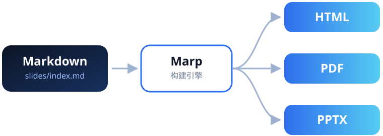

<!-- _class: lead -->

# 用 Markdown 做演示

## 一份内容源，导出 HTML / PDF / PPTX

<span class="badge">纯文本</span> <span class="badge">可版本管理</span> <span class="badge">离线可用</span> <span class="badge">实时预览</span>

---

## 这套工作区解决了什么？

- **内容即 Markdown** — `slides/index.md` 是唯一内容源，专注写作
- **样式即 CSS** — `themes/copilot.css` 统一视觉，换主题不动内容
- **一键多格式** — 自包含 HTML、矢量 PDF、可编辑 PPTX
- **离线演示** — 导出的 HTML 是单文件，拷进 U 盘双击即播
- **所见即所得** — `npm run preview` 保存即刷新

> **核心思路**：内容与样式彻底分离。改一行 Markdown，所有格式自动重生成。

---

<!-- _class: divider -->

# 目录

## 结构 · 命令 · 语法 · 导出

---

## 目录结构

```text
PPT/
├─ slides/
│  ├─ index.md          ← 幻灯片内容（唯一需要编辑的文件）
│  └─ images/           ← 图片与插图
├─ themes/
│  └─ copilot.css       ← 自定义主题（配色 / 字体 / 版式）
├─ dist/                ← 构建产物（html / pdf / pptx）
├─ package.json         ← 命令与依赖
└─ README.md            ← 使用说明
```

> 日常只需要碰 `slides/index.md` 和 `themes/copilot.css` 两个文件。

---

## 常用命令

| 命令 | 作用 |
| --- | --- |
| `npm run preview` | 启动实时预览，保存后自动刷新 |
| `npm run build:html` | 导出单文件 HTML（离线可用） |
| `npm run build:pdf` | 导出 PDF（矢量，适合打印 / 分享） |
| `npm run build:pptx` | 导出 PPTX（可在 Office 继续编辑） |
| `npm run build` | 一次性导出以上三种格式 |

> 所有产物统一输出到 `dist/` 目录。

---

## 分栏版式：一次对比两件事

<div class="columns">
<div>

### 写内容

- 支持 **粗体**、*斜体*、`行内代码`
- 列表、引用、表格、代码块开箱即用
- 需要精细排版时可插入原生 HTML

</div>
<div>

### 控版式

- 每页用 `---` 分隔
- `<!-- _class: lead -->` 生成封面页
- `<!-- _class: divider -->` 生成章节页

</div>
</div>

---

## 导出流程



---

## 代码与表格都不在话下

```js
// 一条命令，导出全部格式
const formats = ['html', 'pdf', 'pptx'];
formats.forEach((format) => build('slides/index.md', format));
```

| 特性 | Markdown 方案 | 传统 PPT |
| --- | --- | --- |
| 版本管理 | ✅ diff 清晰可审阅 | ❌ 二进制文件 |
| 多格式导出 | ✅ 一键全部生成 | ⚠️ 需手动另存 |
| 排版一致性 | ✅ 样式全局统一 | ⚠️ 容易错位 |

---

<!-- _class: lead -->

# 开始写你的内容

## 打开 `slides/index.md`，把这一页替换成你的主题

<span class="badge">编辑</span> <span class="badge">保存</span> <span class="badge">npm run build</span>
